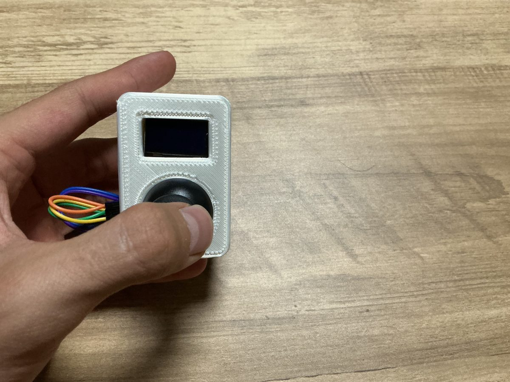
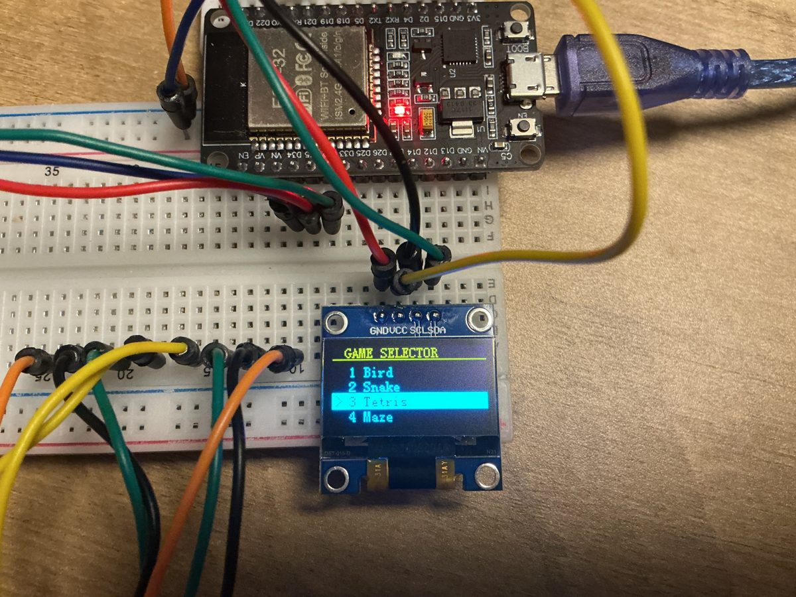
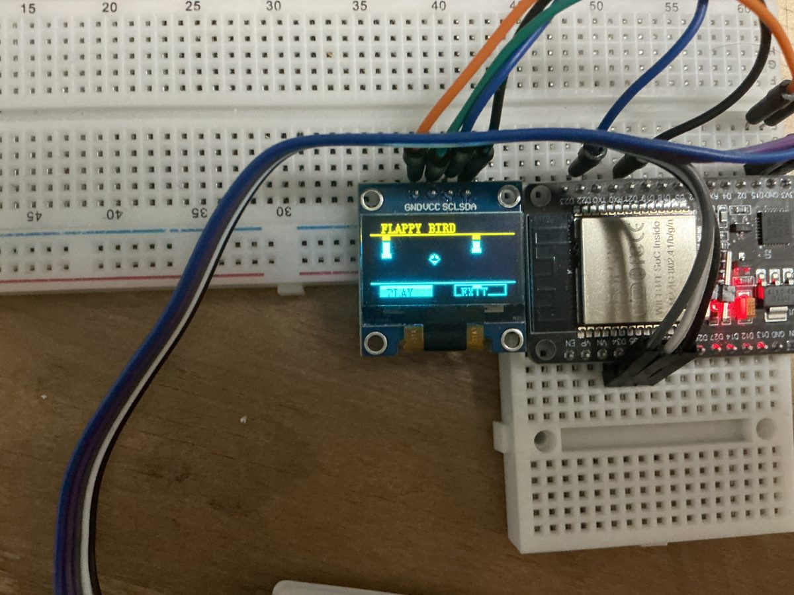
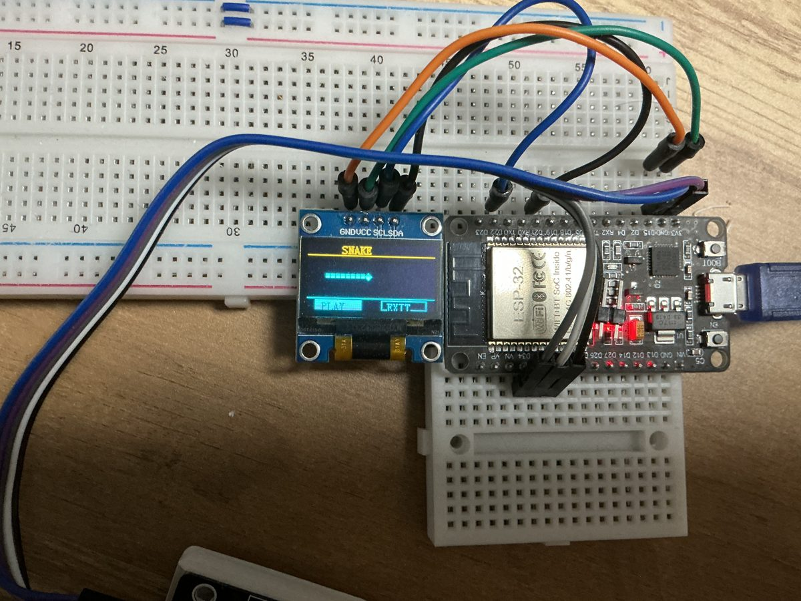
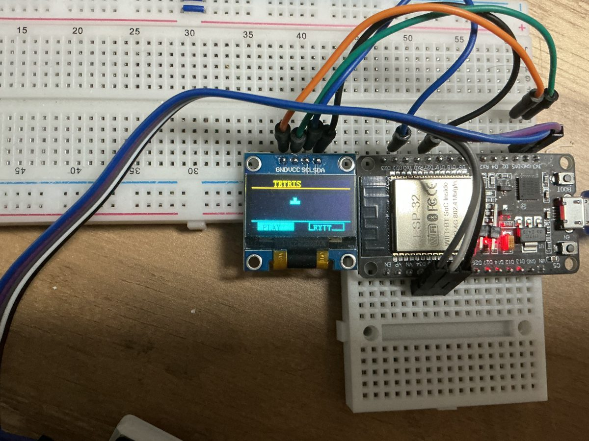
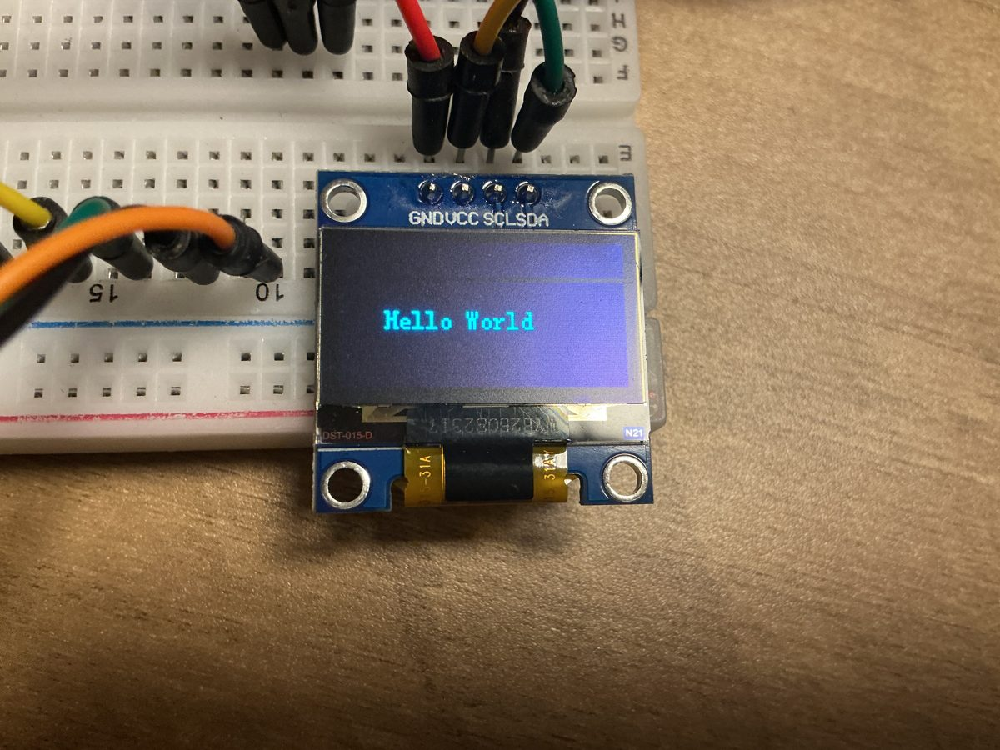
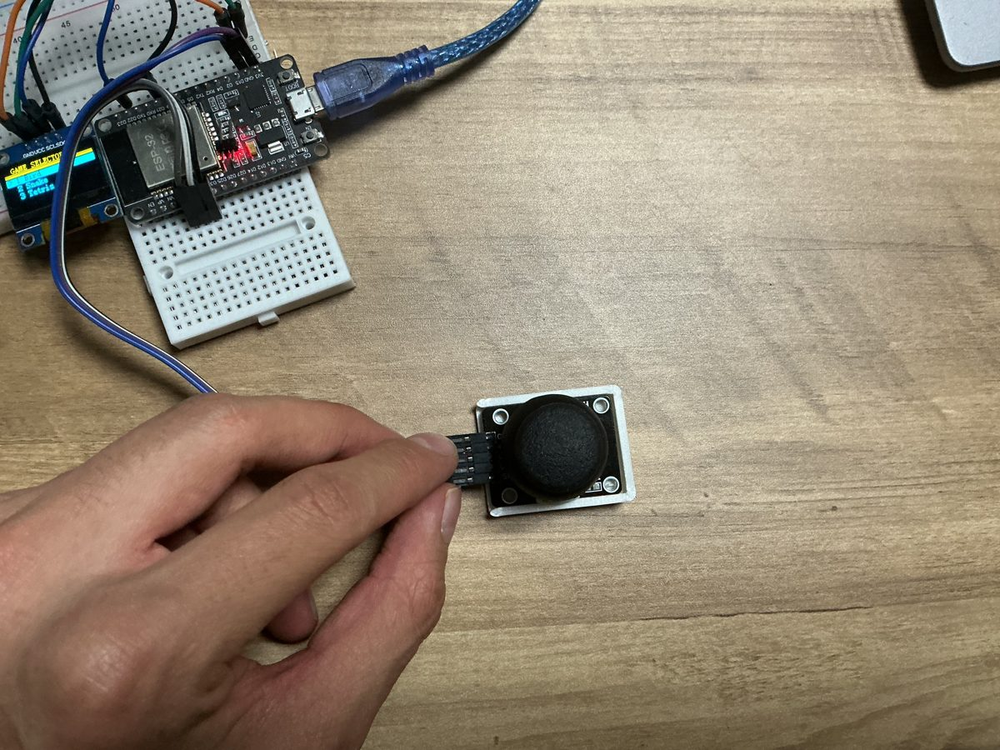
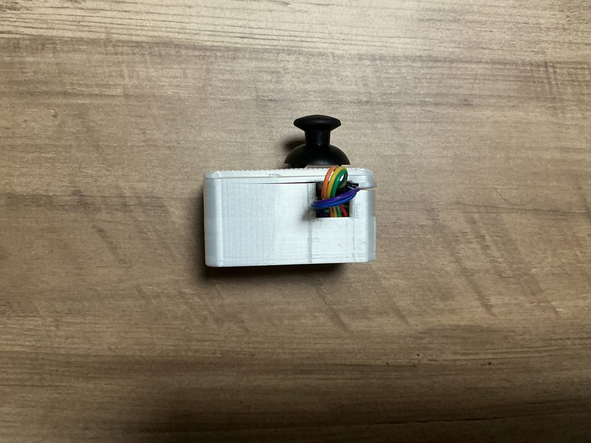

# ESP32 Handheld Game Console

A handheld console running three games I wrote from scratch in C: Flappy Bird, Snake and Tetris. Firmware is on ESP-IDF (not Arduino), the display is a 128×64 SSD1306 OLED over I²C, input is an analog joystick, and the enclosure is designed in Fusion 360 and printed on my own printer.

<p align="center">
  
</p>

| Game selector | Flappy Bird | Snake | Tetris |
|---|---|---|---|
|  |  |  |  |

Videos: [demo](https://www.youtube.com/watch?v=Bn7Uy6IJS7Y) · [build progress](https://www.youtube.com/watch?v=tJ3czAZk3TU)

## How it works

```
 KY-023 joystick                    ESP32-WROOM-32                     SSD1306 OLED
 VRx ──────────── GPIO34 (ADC1_CH6) ┐                           ┌── GPIO21 SDA ── SDA
 VRy ──────────── GPIO35 (ADC1_CH7) ├─ read_input() ─ screen FSM ┤
 SW  ──────────── GPIO32 (pull-up)  ┘        │                  └── GPIO22 SCL ── SCL   (I²C, 400 kHz, 0x3C)
                                       game tick + draw
                                       every 50 ms loop
```

All of the firmware is one file, [`main/main.c`](main/main.c), organized as a screen state machine:

```
HOME ──select──▶ <GAME>_SPLASH ──PLAY──▶ <GAME>_GAME ──collision──▶ <GAME>_OVER
  ▲                   │                                               │      │
  └──────EXIT─────────┘◀──────────────────────────EXIT────────────────┘   AGAIN ──▶ <GAME>_GAME
```

Ten states (home, plus splash / game / game-over for each of the three games) share one input handler and one draw dispatcher, so adding a fourth game means adding three states, not a new menu system.

## Design decisions

**ESP-IDF instead of Arduino.** I did this on purpose to learn the real toolchain: CMake and Ninja, component structure, `menuconfig`, and the `idf.py build flash monitor` loop. The OLED driver comes in through the ESP-IDF component manager (`espressif/ssd1306`), not a library copied into the project.

**My own drawing layer on top of the driver.** The driver only gives me single pixels and text, so I wrote the rest: rectangles, lines, and Bresenham midpoint circles (outline and filled). Every sprite (the bird, pipes, snake segments, Tetris blocks) is built from those.

**One input handler with two lockout windows.** The joystick is read every loop. Menus ignore new input for 200 ms after a move, so one push moves the cursor one step. Games use a shorter 120 ms window so controls still feel responsive. A deadzone of ±1000 counts around the 12-bit center (2048) stops ADC noise from registering as a move.

**Each game is a small, self-contained module.**
- *Flappy Bird*: integer gravity and flap velocity, three recycled pipes with randomized gaps, box collision using the bird's radius.
- *Snake*: a 32×13 grid in 4-pixel cells, the body stored as an array that shifts one cell per step, a rule that blocks 180° reversals, and food placement that never lands on the body.
- *Tetris*: a 10×16 board, all seven tetrominoes, rotation that is rejected if it would collide, line clearing, and gravity on its own 400 ms timer, separate from the input rate.

**A tiny xorshift RNG** seeded from the tick count at boot, so pipe gaps, food and piece order differ every power-up without pulling in `rand()`.

## What broke and what I changed

- **The joystick hurt to hold.** The breakout board's solder tails dug into my hand, so I printed a cover for the joystick before the console body existed.
- **Cable exit.** Routing the USB cable inside the body made it too thick to pocket, so the cable leaves through the side.
- **Tuning Flappy Bird for a 64-pixel screen.** I widened the pipe gap from 18 to 28 px and shrank the bird's radius from 6 to 4 px.

| Breadboard bring-up | Joystick cover | Printed enclosure |
|---|---|---|
|  |  |  |

The first thing I got running was text on the OLED. That bring-up program is kept in [`bringup/oled_hello_world.c`](bringup/oled_hello_world.c). It has its own `app_main()`, so it isn't part of the build.

## Known limitations and next steps

- **Game speed is tied to the loop.** Flappy Bird and Snake advance one step per loop iteration, and the loop is `vTaskDelay(50 ms)` *plus* drawing time, so a frame that takes longer to draw also slows the game. Tetris gravity is already on its own timer. Next: switch the main loop to `vTaskDelayUntil()` so the period is a true 50 ms.
- **Legacy drivers.** It uses the legacy ADC (`driver/adc.h`) and I²C drivers, which still build on ESP-IDF 5.5 but are deprecated. Next: port to `esp_adc/adc_oneshot` and `driver/i2c_master`.
- **Full redraw every frame.** Each frame clears and redraws the whole 1 KB frame buffer. That's fine at 20 fps, but it's the first thing to optimize.
- **No high score saved.** Next: keep a best score per game in NVS.

## Build and flash

Built with **ESP-IDF v5.5.2** on an ESP32-WROOM-32 DevKitC.

```bash
idf.py set-target esp32
idf.py build
idf.py -p <PORT> flash monitor      # e.g. COM5 on Windows, /dev/ttyUSB0 on Linux
```

The first build downloads the `espressif/ssd1306` component automatically.

### Parts

| Part | Notes |
|---|---|
| ESP32-WROOM-32 DevKitC v4 | any ESP32 dev board with GPIO 21/22/32/34/35 free |
| SSD1306 OLED, 128×64, I²C | address 0x3C |
| KY-023 analog joystick | VRx, VRy, push switch |
| Printed enclosure | Fusion 360, FDM |

### Wiring

| Signal | ESP32 |
|---|---|
| OLED SDA | GPIO 21 |
| OLED SCL | GPIO 22 |
| Joystick VRx | GPIO 34 (ADC1_CH6) |
| Joystick VRy | GPIO 35 (ADC1_CH7) |
| Joystick SW | GPIO 32 (internal pull-up, active low) |
| OLED and joystick VCC / GND | 3.3 V / GND |

## Repo layout

```
main/main.c               all firmware: drawing, input, screen FSM, three games
main/idf_component.yml    pulls espressif/ssd1306 from the component registry
bringup/                  first OLED test program (not built)
docs/images/              photos
```

---
Pedro Zambrano-Saucedo · Electrical Engineering, UTEP · [Portfolio](https://pazambranosauc.github.io/pazambranosauc/)
